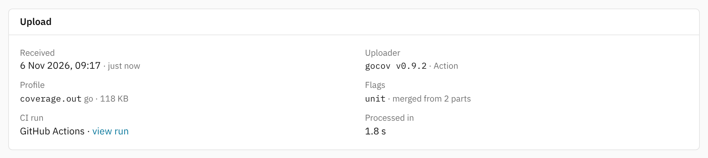

# Multiple reports per commit (parts)

When a commit's coverage comes from several jobs — a backend suite, a frontend suite, an e2e run — give each upload a
`part` so gocov combines them instead of letting the last one win:

```sh
gocov upload -part backend  coverage.out
gocov upload -part frontend coverage/lcov.info
gocov upload -part e2e      e2e-lcov.info
```

The part name can also come from `$GOCOV_PART`, which is handy for matrix jobs that already expose the variant in the
environment.

gocov keeps every upload but derives a **merged report** per commit from the latest upload of each part, and drives the
status, gate, PR comment, Code Insights, badge and trend from that merged report. The repo page's file list is the
merged report's too: it shows every part's files together (a Go backend's and a TypeScript frontend's side by side),
and each file's source view shows the same merged coverage as its row. An upload's own page still shows only that upload's
files; for a commit uploaded in more than one part it links to the same page with every part merged, which is where the
PR comment, the build status and Code Insights link, so the figure they state is the one you land on. Re-uploading a part (a CI retry)
replaces it rather than double-counting. When two parts report the same file, their line hit counts are summed, so a
line covered by any part counts as covered.



Part names are normalized (trimmed and lowercased) server-side, so
`Backend` and `backend` are the same part. Uploads without a `part` use the reserved name `default`; passing
`-part default` explicitly lands in that same bucket, so single-job setups are unchanged — a one-part merged report
equals the upload.

Parts are merged as they arrive, in place. gocov does **not** wait for a fixed set of parts: while the jobs are still
uploading, the merged report reflects only the parts received so far, so its total can read low and the gate can fail
until the last part lands, then correct itself. Each upload step's log says which parts its figure covers
(`merged from 1 part so far: web`), so an interim total is easy to tell apart — see
[CLI output](cli.md#output-and-exit-code). If a reviewer merges inside that window they may see an interim gate —
sequence the gate check after all coverage jobs, or wait for the final status. Parts that finish at the same moment
do not queue on each other: one upload updates the forge, and the others report its surfaces as `queued` and return at
once. That update then goes round again with every part received meanwhile, so the forge always ends on the newest
merged report. A future
`expected_parts` setting will let a repo hold status until every part is in; until then the self-healing behaviour above
is the model, and parts you [carry forward](#carrying-a-part-forward) never read low while they are in flight.

A part that does not run at all is the other half of this: unless the repository carries it forward, the merged total
drops until it lands. See [Why coverage changed](coverage-changed.md).

## Carrying a part forward

Some pipelines run a job only when its paths change — the e2e suite when the web app changes, the backend tests when
the backend does. A commit that skipped the job uploads no part for it, and its merged report would leave those
statements out: the total drops, the trend zigzags and the gate can fail although no code lost coverage. List such parts
under **Carried parts** in the repository's settings, one name per line as the upload step names it, and a commit that
did not upload one of them takes it from the history before it instead.

- **Where it comes from.** The newest earlier report on the commit's branch that has the part — uploaded there, or
  carried there in turn, so the figure is always the upload that last measured it — and, for a branch's first builds,
  the default branch. Earlier means seen by gocov before this commit was, so re-running CI on an old commit never takes
  a part from a newer one.
- **What it counts in.** The total, the delta, the gate, the trend, the badge and the files list, whose rows for the
  carried part link to the upload that measured it.
- **What it doesn't.** Diff coverage comes from the commit's own parts only: a carried part was measured on other code,
  so it says nothing about this pull request's changed lines. A changed file only the carried part covers is listed as
  a changed file without coverage data.
- **Where it shows.** The upload step's log adds a `carried forward: e2e from 1a2b3c4` line, and the pull request
  comment and the upload page name each carried part and the commit it came from.
- **While its job is still running.** A carried part also fills in for one that is still uploading: until the commit's
  own upload of it lands, the previous one stands in, then the commit's replaces it. The interim total does not drop for
  that part — but the gate can pass on the earlier figure and then fail once the new one lands.
- **When a job goes away,** remove its part from the list, or its last numbers keep being carried. For a job that
  failed rather than skipped, fix the job: carrying its part forward would hide the failure.

The setting applies to uploads received from then on; reports already stored keep their numbers.
